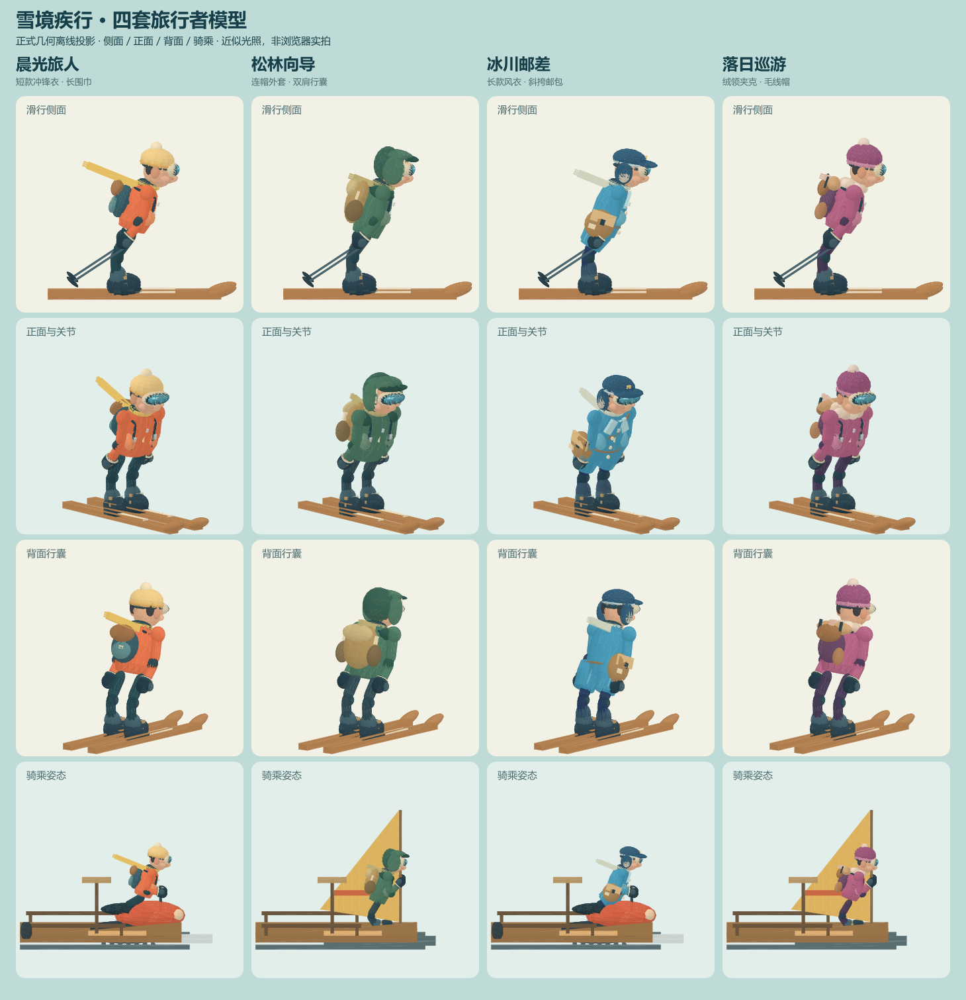

# 旅行者与四套服装模型

本次保留原旅行者身材、正常游戏中的根节点比例，以及原骨架的肢段长度。四套装备沿用原 ID、主题和价格，帽子、衣身、行囊及配件改为不同几何造型。

| ID / 名称 | 造型 |
| --- | --- |
| sunrise / 晨光旅人 | 绒球针织帽、短款冲锋衣、拉链口袋、紧凑旅行背包、长围巾 |
| forest / 松林向导 | 敞脸连帽与帽沿、加厚肩部、较长户外外套、大双肩行囊、侧袋搭扣 |
| glacier / 冰川邮差 | 护耳邮差帽、独立帽檐、翻领长风衣、随左右大腿运动的分叉下摆、斜挎邮包、高筒靴 |
| dusk / 落日巡游 | 厚毛线帽、分区绒领、夹棉夹克、短款背包、顶部卷装与侧袋 |

基础模型补充鼻子、耳朵、脸颊和下颌层次；护目镜分为镜带、框、镜片与反光；手套增加拇指和腕口；靴子增加鞋帮、鞋底及扣带；肩、肘、膝的衣物与连接部件跟随对应关节。骑乘只隐藏明确命名的雪杖组，手套与袖口保持可见。

## 模块职责与扩展

- `src/render/model-factory.ts`：最小部件/材质接口。游戏使用正式共享材质，离线检查注入无 DOM 工厂。
- `src/render/skier-rig.ts`：固定骨架、脸部/手套/靴子、衣物挂点、围巾与衣摆运动。骨架原点、正 x 朝向、前臂 0.44m 及大腿 0.47m 等连接关系沿用原实现。
- `src/render/skier-appearance.ts`：四套服装的独立连续衣身、帽子、包袋、衣袖与裤装几何；不读取 Player、不访问存档。
- `src/render/models.ts`：`Skier` 保留原滑行、落地、空翻、骑乘 IK 和载具调度，委托 Rig 构建人物造型。
- `src/render/world.ts`：换装调用现有 Skier 的 `setStyle`，保留乘客及载具实例。

新增服装时，先在 `OUTFITS` 增加稳定 ID 与价格，再在 appearance 中定义衣身、帽子、行囊和四肢形状。十个 `COSTUME_SLOTS` 分别挂到同名关节。需要独立运动的衣物必须保留命名 Group；邮差衣摆挂在左右大腿，避免一个完整硬筒跨越两腿。不要在物理层按衣服型号分支。

每个工厂按服装 ID 缓存一份模板；默认工厂最多四套。实例拥有自己的节点和动画状态，几何及材质共享。同一关节下的静态部件按材质合并，围巾和两片衣摆分别合并，不跨关节合并。制作衣身时产生的专属源几何在合并后释放；缓存缓冲与全局共享源几何保留。换装移除旧衣物挂点，不对共享材质做原位改色。

## 存档与商店

继续使用 `snowbound.escape.save.v1`，不迁移、不重置。四个装备 ID、160/240/320 雪晶价格和已有购买记录保持一致。试览只更新 World 的预览 ID；购买流程仍由 UI/Storage 处理。已购买装备可直接换装，未购买装备试览不会扣费或解锁，雪具与其购买记录保留。

## 验证与性能边界

- `npm test`：103 项通过，包含 6 项新外观测试。
- 四套帽子/衣身的几何哈希分别不同；衣身使用正向三角形及单面材质，从前后都可正确命中。
- 200 次连续换装后没有旧衣物挂点残留，换回初始服装恢复同样的几何与颜色，载具和乘客实例保留。
- 4 套服装 × 6 种状态（双板及五种骑乘）× 9 种姿态，共 216 组合；检查世界矩阵有限、重复同一模拟时刻不累积偏移、动画不写入 Player。覆盖滑行、腾空、空翻手势、落地、踉跄、能力、收帆缓降、摔倒和胜利姿态。
- 原存档读取、锁定试览、已购装备换装、新装备按原价购买、重复购买不扣费均通过正式 UI/Storage 测试。
- 普通双板姿态：70–78 个可见网格，约 1.74–2.13 万三角形（含双板、脸部、衣物、手套、靴子和雪杖；不含场景）。这是模型规模，不是 FPS 测量。
- `npm run build` 通过。Three.js 厂商包仍有原有的 500kB 分包提示，不影响构建。



上图由正式人物及载具几何在 CPU 上投影，使用近似漫反射，未加载纹理；只检查造型、比例、挂点与布局，不是浏览器实拍。全图有侧面、正面、背面及骑乘四行。导出命令：

```powershell
npx tsx scripts/outfit-preview.ts <sharp模块的绝对路径>
```

模型明细见 `outfit-models.json`。本轮没有新增浏览器 GPU 帧率实测，不能把历史旧版 90–165 FPS 记录当作本次四套新模型的验证结果；60 FPS 以上继续作为性能目标。

## 素材

本次四套服装与基础人物细化均由本项目代码制作，没有下载外部角色模型或引入新的运行时素材服务。
